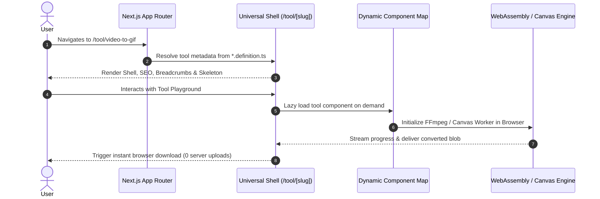
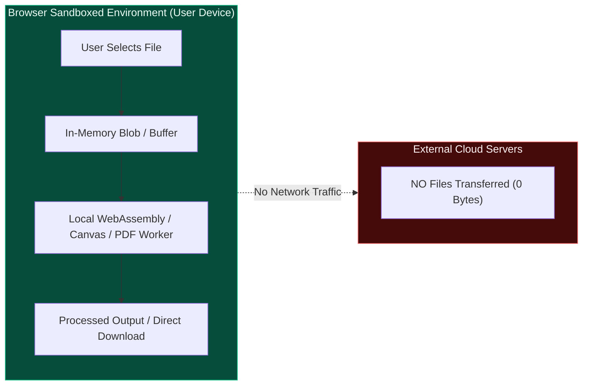

# 🏛️ Zevylo — System Architecture & Codebase Graph

> **Live Production Website**: [https://zevylo.netlify.app/](https://zevylo.netlify.app/)  
> **Source Repository**: [https://github.com/daniyal44/Tools_wesbite](https://github.com/daniyal44/Tools_wesbite)  
> **Privacy-First, 100% In-Browser Execution Engine**  
> All 206+ utility tools execute strictly within the user's web browser using WebAssembly, HTML5 Canvas, Web Audio, and Web Crypto APIs. Zero files or user data are ever uploaded to a remote server.

---

## 📊 Live Codebase Architecture Graph

The diagram below reflects the live architecture of the codebase and updates automatically via our CI/CD pipeline whenever tools, definitions, or modules are added or modified.

```mermaid
%% Dynamic Codebase Graph — Generated on 2026-10-14 (206 tools across 18 categories)
flowchart TB
    subgraph ClientLayer["Client-Side Browser Execution (Zero-Upload Privacy Sandbox)"]
        UserBrowser["🌐 User Web Browser"]
    end

    subgraph AppRouter["Next.js 16 App Router (zevylo/src/app)"]
        Landing["/ — Main Catalog & Hub"]
        CategoryPage["/[category] — Category Portals"]
        ToolDynamicRoute["/tool/[slug] — Universal Dynamic Tool Engine"]
        AIPage["/ai-tools — AI Frontier Directory (A-to-Z)"]
    end

    subgraph CoreComponents["Core UI & Layout Architecture (zevylo/src/components)"]
        Header["Header & Theme Provider"]
        SearchFilter["Global Live Search & Filter Bar"]
        CategoryGrid["Categorized Tool Grid & Badges"]
        ToolWrapper["Tool Playground Shell (Fullscreen, Reset, Export)"]
    end

    subgraph ToolRegistry["Tool Registry & Dynamic Loader (zevylo/src/lib/tools)"]
        ComponentMap["component-map.tsx (Lazy Dynamic Imports)"]
        DefinitionRegistry["*.definition.ts (Metadata, SEO, FAQ, Inputs)"]
    end

    subgraph ToolCategories["Active Tool Suites (206 In-Browser Tools)"]
        CAT_Image["🖼️ Image Suite (34 tools)"]
        CAT_Dev["💻 Developer Suite (27 tools)"]
        CAT_Calc["🧮 Calculator Suite (19 tools)"]
        CAT_Text["📝 Text & Markdown Suite (19 tools)"]
        CAT_Video["🎥 Video & GIF Suite (17 tools)"]
        CAT_AI["🤖 AI Utility Suite (17 tools)"]
        CAT_Convert["🔄 Converters Suite (10 tools)"]
        CAT_SEO["📈 SEO & Web Suite (11 tools)"]
        CAT_PDF["📄 PDF Document Suite (9 tools)"]
        CAT_Audio["🎵 Audio Suite (8 tools)"]
        CAT_Prod["⚡ Productivity Suite (6 tools)"]
        CAT_Gen["🎲 Generators Suite (5 tools)"]
        CAT_Color["🎨 Color Suite (5 tools)"]
        CAT_Other["🛠️ Date, Math, Security, Marketing (19 tools)"]
    end

    subgraph ProcessingEngines["Browser Processing Engines (No Cloud Server Needed)"]
        WASM["⚙️ FFmpeg WebAssembly (Video/Audio Decoding/Encoding)"]
        CanvasAPI["🎨 HTML5 Canvas 2D Engine (Image Resizing, Filters, Icons)"]
        PDFLib["📑 PDF-Lib / PDFJS (Client-side Merging, Splitting, Watermarking)"]
        WebCrypto["🔐 Web Crypto API (Hashes, HMAC, Password Generator)"]
        ClientStorage["💾 IndexedDB / LocalStorage (Offline State & Favorites)"]
    end

    UserBrowser --> AppRouter
    AppRouter --> CoreComponents
    CoreComponents --> ToolWrapper
    ToolWrapper --> ToolRegistry
    ToolRegistry --> ToolCategories
    ToolCategories --> ProcessingEngines

    classDef modern fill:#1e293b,stroke:#3b82f6,stroke-width:2px,color:#f8fafc;
    classDef engine fill:#0f172a,stroke:#10b981,stroke-width:2px,color:#f8fafc;
    classDef client fill:#0369a1,stroke:#38bdf8,stroke-width:2px,color:#ffffff;
    class UserBrowser client;
    class WASM,CanvasAPI,PDFLib,WebCrypto,ClientStorage engine;
    class Landing,CategoryPage,ToolDynamicRoute,AIPage,ComponentMap,DefinitionRegistry modern;
```

<!-- BEGIN_DYNAMIC_CODEBASE_GRAPH -->

<!-- END_DYNAMIC_CODEBASE_GRAPH -->

---

## 📁 Active Tool Category Distribution

<!-- BEGIN_CATEGORY_TABLE -->
| Category | Tool Count | Sample Tools | Directory |
|:---|:---:|:---|:---|
| **IMAGE** | 34 | `ascii-art-generator`, `aspect-ratio-calculator`, `avif-to-jpg`... | [`zevylo/src/tools/image`](zevylo/src/tools/image) |
| **DEVELOPER** | 27 | `base64`, `chmod-calculator`, `code-minifier`... | [`zevylo/src/tools/developer`](zevylo/src/tools/developer) |
| **CALCULATORS** | 19 | `age-calculator`, `average-calculator`, `bmi-calculator`... | [`zevylo/src/tools/calculators`](zevylo/src/tools/calculators) |
| **TEXT** | 19 | `bionic-reading-converter`, `case-converter`, `find-replace`... | [`zevylo/src/tools/text`](zevylo/src/tools/text) |
| **AI** | 17 | `ai-article-writer`, `ai-bio-generator`, `ai-business-name-generator`... | [`zevylo/src/tools/ai`](zevylo/src/tools/ai) |
| **VIDEO** | 17 | `crop-video`, `cut-video`, `gif-to-mp4`... | [`zevylo/src/tools/video`](zevylo/src/tools/video) |
| **SEO** | 11 | `hashtag-generator`, `hreflang-generator`, `keyword-density-analyzer`... | [`zevylo/src/tools/seo`](zevylo/src/tools/seo) |
| **CONVERTERS** | 10 | `binary-text-converter`, `currency-converter`, `data-size-converter`... | [`zevylo/src/tools/converters`](zevylo/src/tools/converters) |
| **PDF** | 9 | `crop-pdf`, `pdf-merge-split`, `pdf-metadata-editor`... | [`zevylo/src/tools/pdf`](zevylo/src/tools/pdf) |
| **AUDIO** | 8 | `audio-speed-changer`, `audio-trimmer`, `metronome`... | [`zevylo/src/tools/audio`](zevylo/src/tools/audio) |
| **DATE-TIME** | 6 | `date-difference-calculator`, `timestamp-converter`, `timezone-converter`... | [`zevylo/src/tools/date-time`](zevylo/src/tools/date-time) |
| **PRODUCTIVITY** | 6 | `bulk-rename`, `coin-flip`, `pomodoro-timer`... | [`zevylo/src/tools/productivity`](zevylo/src/tools/productivity) |
| **COLOR** | 5 | `color-contrast-checker`, `color-converter`, `color-generator`... | [`zevylo/src/tools/color`](zevylo/src/tools/color) |
| **GENERATORS** | 5 | `barcode-generator`, `password-generator`, `qr-code-generator`... | [`zevylo/src/tools/generators`](zevylo/src/tools/generators) |
| **BUSINESS** | 4 | `price-estimator`, `resume-cv-builder`, `profit-loss-calculator`... | [`zevylo/src/tools/business`](zevylo/src/tools/business) |
| **MARKETING** | 4 | `utm-builder`, `bulk-email-generator`, `social-video-downloader-helper`... | [`zevylo/src/tools/marketing`](zevylo/src/tools/marketing) |
| **EDUCATION** | 3 | `gpa-calculator`, `assignment-writing-helper`, `handwriting-generator`... | [`zevylo/src/tools/education`](zevylo/src/tools/education) |
| **SECURITY** | 2 | `hmac-generator`, `password-strength`... | [`zevylo/src/tools/security`](zevylo/src/tools/security) |
| **TOTAL** | **206** | *Fully client-side & in-browser* | 18 Active Suites |

<!-- END_CATEGORY_TABLE -->

---

## 🧩 Architectural Layers

The Zevylo platform is structured into four distinct, decoupled layers:

```
┌─────────────────────────────────────────────────────────────────┐
│                       1. Presentation Layer                     │
│   Next.js 16 App Router • Tailwind CSS v4 • Lucide React Icons  │
│   Theme Provider • Fullscreen Playground Shell • Dynamic Views  │
├─────────────────────────────────────────────────────────────────┤
│                       2. Orchestration Layer                    │
│   Dynamic Component Map (Lazy Imports) • Registry Definition    │
│   Universal Route Engine (/tool/[slug]) • Search & Filter State │
├─────────────────────────────────────────────────────────────────┤
│                       3. Processing Core                        │
│   WebAssembly (FFmpeg) • PDF-Lib • HTML5 Canvas • Web Audio     │
│   Web Crypto API • QR Engine • Zod Schema Validation            │
├─────────────────────────────────────────────────────────────────┤
│                       4. Persistence & Cache                    │
│   Browser IndexedDB • LocalStorage • SessionStorage             │
│   Zero External Server Dependencies • 100% Offline Capable      │
└─────────────────────────────────────────────────────────────────┘
```

### 1. Presentation & Routing Layer (`zevylo/src/app`)
- **Universal Route (`/tool/[slug]/page.tsx`)**: Every tool shares a standardized, high-performance container with dedicated SEO metadata, OpenGraph tags, Breadcrumb JSON-LD, and FAQ schema.
- **Category Portals (`/[category]/page.tsx`)**: Curated hubs aggregating tools by discipline with live filtering, tag search, and quick launch.
- **AI Frontier Directory (`/ai-tools`)**: Dynamic alphabetical index (A through Z) cataloging frontier AI tools and services.

### 2. Tool Definition & Registry Layer (`zevylo/src/tools`)
Every tool adheres to a strict contract defined by its `*.definition.ts` file:
```typescript
export interface ToolDefinition {
  id: string;              // Unique identifier (e.g., 'image-resizer')
  slug: string;            // URL slug matching route (/tool/image-resizer)
  name: string;            // User-friendly display title
  category: ToolCategory;  // e.g., 'image', 'developer', 'pdf', 'video'
  subcategory: string;     // Fine-grained grouping
  icon: string;            // Lucide icon identifier
  shortDescription: string;// Concise card description
  longDescription: string; // Exhaustive SEO & instructional overview
  features: string[];      // Bullet highlights
  keywords: string[];      // Search indexing terms
  faq: Array<{ question: string; answer: string }>;
}
```

### 3. Dynamic Component Loader (`zevylo/src/lib/tools/component-map.tsx`)
- Heavy processing libraries (e.g., `@ffmpeg/ffmpeg`, `pdf-lib`) are **never bundled in the main bundle**.
- Each tool component is loaded on-demand via `next/dynamic` with `ssr: false`, ensuring instant initial page loads (<100ms FCP) and minimal JavaScript payload.



---

## 🔒 Security & Privacy Model



1. **Zero Cloud Uploads**: Files never leave user RAM. Processing occurs via WebAssembly, Web Audio API, Canvas 2D, or pure TypeScript algorithms.
2. **CSP Hardening**: Strict Content Security Policy preventing unauthorized script injections or external exfiltration.
3. **Ephemeral State**: Refreshing or closing the tab instantly clears all file blobs and buffers from memory.

---

## 🔄 Dynamic Graph Automation

To keep this document synchronized with the growing tool ecosystem:
- **Local Hook**: [`github.bat`](github.bat) triggers `node scripts/generate-codebase-graph.mjs` before committing.
- **CI Workflow**: [`.github/workflows/update-graph.yml`](.github/workflows/update-graph.yml) validates and updates diagrams on every push to `main`.
