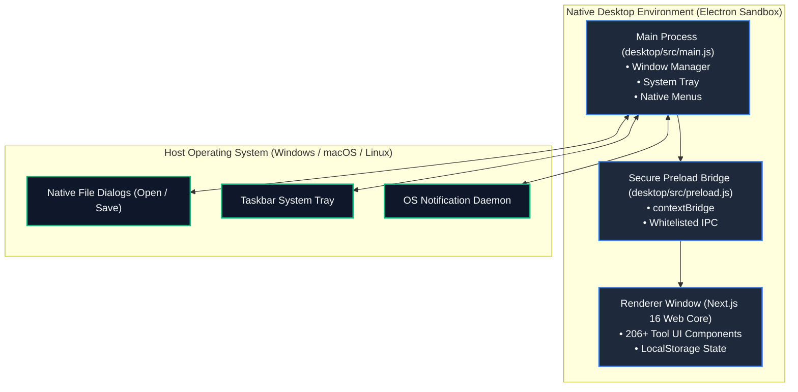

# 🖥️ Zevylo Desktop Application Guide

> **Open-Source Cross-Platform Desktop Client for Zevylo**  
> Run all 206+ in-browser privacy-first utilities as a standalone desktop application on **Windows**, **macOS**, and **Linux**.

[](desktop)
[](LICENSE)
[](https://github.com/daniyal44)

---

## 🌟 Desktop Advantages

While Zevylo runs inside modern web browsers, the native desktop application provides distinct advantages:

1. ⚡ **Dedicated Isolated Workspace**: No browser tab clutter. Operates as an independent app window with window memory and position restore.
2. 🗂️ **System Tray Quick Launcher**: Lives in your Windows Taskbar / macOS Menu Bar with 1-click shortcuts directly into Image, PDF, Developer, and Video tool categories.
3. 🔔 **Native OS Notifications**: Alerts you when intensive WebAssembly operations (video conversion, audio rendering, bulk conversions) complete.
4. ⌨️ **Global System Shortcuts**: Quick access to tools from anywhere across your operating system.
5. 🛡️ **Zero Cloud Uploads**: Identical 100% client-side privacy model. All operations run directly on your CPU/GPU.

---

## 🏗️ Architecture & Security Model



### Security Invariants:
- `contextIsolation: true`: Isolates Node.js execution completely from the web renderer.
- `nodeIntegration: false`: Strictly prohibits `require()` from renderer DOM.
- `sandbox: true`: Standard OS-level Chromium sandboxing.
- `COOP + COEP Headers`: Cross-Origin Isolation enables multi-threaded WebAssembly (`SharedArrayBuffer`).

---

## 🚀 How to Run & Build

### Running in Development Mode
```bash
# 1. Install desktop dependencies
cd desktop
npm install

# 2. Start desktop client in dev mode
npm run dev
```

### Building Standalone Executables & Installers
```bash
# Generate Windows NSIS Installer & Portable Executable
npm run dist:win

# Generate macOS DMG
npm run dist:mac

# Generate Linux AppImage & Debian package
npm run dist:linux
```
Output files will be generated in `desktop/dist/`:
- `Zevylo Setup 1.0.0.exe` (Windows Installer)
- `Zevylo 1.0.0.exe` (Windows Portable Binary)

---

## ⌨️ Native Shortcuts & Menus

| Shortcut | Action | Scope |
|:---|:---|:---:|
| `Ctrl+H` / `Cmd+H` | Return to Home / All Tools | In-App |
| `Ctrl+K` / `Cmd+K` | Open Instant Search Modal | In-App |
| `Ctrl+Shift+T` | Focus / Bring Zevylo to Front | Global |
| `F11` | Toggle Fullscreen | In-App |
| `Ctrl+R` / `Cmd+R` | Reload Page | In-App |
| `Ctrl+Shift+I` | Toggle Developer Tools | In-App (Dev) |

---

<div align="center">
  <b>Built by Muhammad Daniyal (<a href="https://github.com/daniyal44">@daniyal44</a>)</b>
</div>
