<div align="center">

# ⚡ ZEVYLO (Tools Website)
### *One Place. Every Useful Tool. (100% Free & In-Browser)*

[](https://nextjs.org/)
[](https://react.dev/)
[](https://www.typescriptlang.org/)
[](https://tailwindcss.com/)
[](https://webassembly.org/)
[](LICENSE)
[](SECURITY_AND_PRIVACY.md)

<p align="center">
  <b>A comprehensive, open-source browser utility ecosystem featuring 206+ tools.</b><br>
  Convert, calculate, generate, analyze, optimize, and create without uploading your files to third-party servers.
</p>

[Explore Tools](TOOLS_DIRECTORY.md) • [Architecture](ARCHITECTURE.md) • [Project Structure](PROJECT_STRUCTURE.md) • [Contributing](CONTRIBUTING.md) • [Security & Privacy](SECURITY_AND_PRIVACY.md)

---

</div>

## 🌟 Why Zevylo?

Most popular online converters and utilities (such as SmallSEOTools, iLovePDF, Ezgif, TinyPNG) force you to upload private photos, confidential PDFs, and personal videos to their remote cloud servers.

**Zevylo operates on an entirely different paradigm:**
- 🛡️ **100% Client-Side Privacy**: All file conversions, video rendering, PDF manipulations, and calculations run inside your browser. No files are ever uploaded anywhere.
- ⚡ **Zero Cloud Latency**: Instant processing powered by **WebAssembly (FFmpeg)**, **HTML5 Canvas**, **PDF-Lib**, and **Web Crypto APIs**.
- 🚫 **Zero Paywalls & Zero Artificial Limits**: No file size caps, no hourly limits, no subscription popups.
- 📱 **Responsive & Accessible**: Dark/Light mode, mobile-first design, keyboard accessible.

---

## 📊 Live Codebase Architecture Graph

The graph below visualizes how requests route from the client browser through the Next.js 16 App Router, into the lazy-loaded Tool Registry, and execute on the browser's local processing engines. **This graph is synchronized with the repository automatically.**

```mermaid
%% Dynamic Codebase Graph — Generated on 2026-10-14 (206 tools across 18 categories)
flowchart TB
    subgraph ClientLayer["Client-Side Browser Execution (Zero-Upload Privacy Sandbox)"]
        UserBrowser["🌐 User Web Browser"]
    end

    subgraph AppRouter["Next.js 16 App Router (zevylo/src/app)"]
        Landing["/ — Main Catalog & Hub"]
        CategoryPage["/[category] — Category Portals"]
        ToolDynamicRoute["/tool/[slug] — Universal Dynamic Tool Engine"]
        AIPage["/ai-tools — AI Frontier Directory (A-to-Z)"]
    end

    subgraph CoreComponents["Core UI & Layout Architecture (zevylo/src/components)"]
        Header["Header & Theme Provider"]
        SearchFilter["Global Live Search & Filter Bar"]
        CategoryGrid["Categorized Tool Grid & Badges"]
        ToolWrapper["Tool Playground Shell (Fullscreen, Reset, Export)"]
    end

    subgraph ToolRegistry["Tool Registry & Dynamic Loader (zevylo/src/lib/tools)"]
        ComponentMap["component-map.tsx (Lazy Dynamic Imports)"]
        DefinitionRegistry["*.definition.ts (Metadata, SEO, FAQ, Inputs)"]
    end

    subgraph ToolCategories["Active Tool Suites (206 In-Browser Tools)"]
        CAT_Image["🖼️ Image Suite (34 tools)"]
        CAT_Dev["💻 Developer Suite (27 tools)"]
        CAT_Calc["🧮 Calculator Suite (19 tools)"]
        CAT_Text["📝 Text & Markdown Suite (19 tools)"]
        CAT_Video["🎥 Video & GIF Suite (17 tools)"]
        CAT_AI["🤖 AI Utility Suite (17 tools)"]
        CAT_Convert["🔄 Converters Suite (10 tools)"]
        CAT_SEO["📈 SEO & Web Suite (11 tools)"]
        CAT_PDF["📄 PDF Document Suite (9 tools)"]
        CAT_Audio["🎵 Audio Suite (8 tools)"]
        CAT_Prod["⚡ Productivity Suite (6 tools)"]
        CAT_Gen["🎲 Generators Suite (5 tools)"]
        CAT_Color["🎨 Color Suite (5 tools)"]
        CAT_Other["🛠️ Date, Math, Security, Marketing (19 tools)"]
    end

    subgraph ProcessingEngines["Browser Processing Engines (No Cloud Server Needed)"]
        WASM["⚙️ FFmpeg WebAssembly (Video/Audio Decoding/Encoding)"]
        CanvasAPI["🎨 HTML5 Canvas 2D Engine (Image Resizing, Filters, Icons)"]
        PDFLib["📑 PDF-Lib / PDFJS (Client-side Merging, Splitting, Watermarking)"]
        WebCrypto["🔐 Web Crypto API (Hashes, HMAC, Password Generator)"]
        ClientStorage["💾 IndexedDB / LocalStorage (Offline State & Favorites)"]
    end

    UserBrowser --> AppRouter
    AppRouter --> CoreComponents
    CoreComponents --> ToolWrapper
    ToolWrapper --> ToolRegistry
    ToolRegistry --> ToolCategories
    ToolCategories --> ProcessingEngines

    classDef modern fill:#1e293b,stroke:#3b82f6,stroke-width:2px,color:#f8fafc;
    classDef engine fill:#0f172a,stroke:#10b981,stroke-width:2px,color:#f8fafc;
    classDef client fill:#0369a1,stroke:#38bdf8,stroke-width:2px,color:#ffffff;
    class UserBrowser client;
    class WASM,CanvasAPI,PDFLib,WebCrypto,ClientStorage engine;
    class Landing,CategoryPage,ToolDynamicRoute,AIPage,ComponentMap,DefinitionRegistry modern;
```

<!-- BEGIN_DYNAMIC_CODEBASE_GRAPH -->

<!-- END_DYNAMIC_CODEBASE_GRAPH -->

---

## 🗂️ Active Tool Categories (206+ Built-in Tools)

<!-- BEGIN_CATEGORY_TABLE -->
| Category | Tool Count | Sample Tools | Directory |
|:---|:---:|:---|:---|
| **IMAGE** | 34 | `ascii-art-generator`, `aspect-ratio-calculator`, `avif-to-jpg`... | [`zevylo/src/tools/image`](zevylo/src/tools/image) |
| **DEVELOPER** | 27 | `base64`, `chmod-calculator`, `code-minifier`... | [`zevylo/src/tools/developer`](zevylo/src/tools/developer) |
| **CALCULATORS** | 19 | `age-calculator`, `average-calculator`, `bmi-calculator`... | [`zevylo/src/tools/calculators`](zevylo/src/tools/calculators) |
| **TEXT** | 19 | `bionic-reading-converter`, `case-converter`, `find-replace`... | [`zevylo/src/tools/text`](zevylo/src/tools/text) |
| **AI** | 17 | `ai-article-writer`, `ai-bio-generator`, `ai-business-name-generator`... | [`zevylo/src/tools/ai`](zevylo/src/tools/ai) |
| **VIDEO** | 17 | `crop-video`, `cut-video`, `gif-to-mp4`... | [`zevylo/src/tools/video`](zevylo/src/tools/video) |
| **SEO** | 11 | `hashtag-generator`, `hreflang-generator`, `keyword-density-analyzer`... | [`zevylo/src/tools/seo`](zevylo/src/tools/seo) |
| **CONVERTERS** | 10 | `binary-text-converter`, `currency-converter`, `data-size-converter`... | [`zevylo/src/tools/converters`](zevylo/src/tools/converters) |
| **PDF** | 9 | `crop-pdf`, `pdf-merge-split`, `pdf-metadata-editor`... | [`zevylo/src/tools/pdf`](zevylo/src/tools/pdf) |
| **AUDIO** | 8 | `audio-speed-changer`, `audio-trimmer`, `metronome`... | [`zevylo/src/tools/audio`](zevylo/src/tools/audio) |
| **DATE-TIME** | 6 | `date-difference-calculator`, `timestamp-converter`, `timezone-converter`... | [`zevylo/src/tools/date-time`](zevylo/src/tools/date-time) |
| **PRODUCTIVITY** | 6 | `bulk-rename`, `coin-flip`, `pomodoro-timer`... | [`zevylo/src/tools/productivity`](zevylo/src/tools/productivity) |
| **COLOR** | 5 | `color-contrast-checker`, `color-converter`, `color-generator`... | [`zevylo/src/tools/color`](zevylo/src/tools/color) |
| **GENERATORS** | 5 | `barcode-generator`, `password-generator`, `qr-code-generator`... | [`zevylo/src/tools/generators`](zevylo/src/tools/generators) |
| **BUSINESS** | 4 | `price-estimator`, `resume-cv-builder`, `profit-loss-calculator`... | [`zevylo/src/tools/business`](zevylo/src/tools/business) |
| **MARKETING** | 4 | `utm-builder`, `bulk-email-generator`, `social-video-downloader-helper`... | [`zevylo/src/tools/marketing`](zevylo/src/tools/marketing) |
| **EDUCATION** | 3 | `gpa-calculator`, `assignment-writing-helper`, `handwriting-generator`... | [`zevylo/src/tools/education`](zevylo/src/tools/education) |
| **SECURITY** | 2 | `hmac-generator`, `password-strength`... | [`zevylo/src/tools/security`](zevylo/src/tools/security) |
| **TOTAL** | **206** | *Fully client-side & in-browser* | 18 Active Suites |

<!-- END_CATEGORY_TABLE -->

> 📖 **Browse the complete tools catalog with detailed descriptions in [TOOLS_DIRECTORY.md](TOOLS_DIRECTORY.md).**

---

## 📂 Project Repository Structure

```
Tools_wesbite/
├── .github/
│   └── workflows/
│       └── update-graph.yml       # Automated CI workflow to update graph & tool docs
├── docs/                          # Architecture & design documentation
├── scripts/
│   └── generate-codebase-graph.mjs# Live codebase graph & metrics generator
├── zevylo/                        # Next.js 16 core web application
│   ├── public/                    # Static assets, icons, fonts, llms.txt
│   ├── scripts/
│   │   └── generate-tool-docs.mjs # Tool definition parser & markdown doc generator
│   ├── src/
│   │   ├── app/                   # App Router pages (/tool/[slug], /ai-tools, /[category])
│   │   ├── components/            # UI components, layout, header, footer, shell
│   │   ├── lib/                   # Utilities, AI directory data, dynamic component map
│   │   └── tools/                 # 206+ modular tool components & *.definition.ts files
│   │       ├── ai/                # AI generators, prompts, schema tools
│   │       ├── audio/             # Audio converters, trim, pitch, BPM
│   │       ├── calculators/       # Math, finance, health, time calculators
│   │       ├── color/             # Color picker, converter, contrast, palettes
│   │       ├── converters/        # File, unit, number, encoding converters
│   │       ├── developer/         # JSON, SQL, Base64, RegEx, diff checkers
│   │       ├── image/             # Resizer, crop, filters, SVG, ICO, WebP
│   │       ├── pdf/               # Merge, split, compress, watermark, rotate
│   │       ├── productivity/      # Timers, boards, signatures, notes
│   │       ├── text/              # Word count, case converter, lorems, slugify
│   │       └── video/             # FFmpeg WASM video trimmer, crop, reverse, GIF
│   ├── package.json               # Next.js dependencies & scripts
│   └── tsconfig.json              # TypeScript strict configuration
├── .gitignore                     # Git exclusion rules
├── ARCHITECTURE.md                # In-depth architectural design & data flow
├── CHANGELOG.md                   # Release history & feature log
├── CONTRIBUTING.md                # Guide to adding new tools & submitting PRs
├── DEPLOYMENT.md                  # Production deployment guide (Vercel, Netlify, Docker)
├── github.bat                     # 1-Click Git push & sync script for Windows
├── package.json                   # Root monorepo workspace orchestration
├── PROJECT_STRUCTURE.md           # Deep dive into folder architecture & file roles
├── README.md                      # Flagship presentation documentation (this file)
├── ROADMAP.md                     # Upcoming features, PWA, local AI models
├── SECURITY_AND_PRIVACY.md        # Detailed security & client-side privacy audit
└── TOOLS_DIRECTORY.md             # Complete alphabetical directory of all 206 tools
```

---

## 🚀 Quick Start Guide

### Prerequisites
- **Node.js**: v18.18.0 or higher
- **npm**, **pnpm**, or **yarn**

### 1. Clone the Repository
```bash
git clone https://github.com/daniyal44/Tools_wesbite.git
cd Tools_wesbite
```

### 2. Install Dependencies
You can install dependencies for the Next.js app:
```bash
cd zevylo
npm install
```

### 3. Start the Development Server
From the root directory:
```bash
npm run dev
# or from inside /zevylo:
npm run dev
```

Open [http://localhost:3000](http://localhost:3000) in your browser.

### 4. Build for Production
```bash
npm run build
```

---

## 🛠️ Adding a New Tool (3 Simple Steps)

Zevylo is designed to make contributing new tools effortless:

1. **Create the Tool Definition** (`zevylo/src/tools/<category>/my-tool.definition.ts`):
   Define tool metadata, SEO descriptions, keywords, and FAQs.
2. **Create the Tool Component** (`zevylo/src/tools/<category>/my-tool.tsx`):
   Build your interactive React component using Tailwind CSS and local state.
3. **Register the Tool**:
   Export it in `zevylo/src/tools/<category>/index.ts` and register dynamic import in `zevylo/src/lib/tools/component-map.tsx`.

Run doc generator:
```bash
npm run docs:all
```
Your tool will automatically appear in the catalog, search index, sitemap, and architecture graphs!

---

## 📚 Complete Documentation Suite

| Document | Purpose |
|:---|:---|
| ⚠️ [**UNIVERSAL_RULE.md**](UNIVERSAL_RULE.md) | **Permanent preservation law — Zero deletion invariant for project and code** |
| 👑 [**CONTRIBUTORS.md**](CONTRIBUTORS.md) | Lead architect & author profile (**Muhammad Daniyal @daniyal44**) |
| 🌟 [**FEATURES.md**](FEATURES.md) | Exhaustive breakdown of all platform features, search, routing, and workspaces |
| 🎨 [**DESIGN_SYSTEM.md**](DESIGN_SYSTEM.md) | Design tokens, dark/light themes, typography, spacing, and component styling |
| 🔘 [**BUTTONS_AND_CONTROLS.md**](BUTTONS_AND_CONTROLS.md) | Comprehensive catalog of all buttons, inputs, modals, sliders, and controls |
| ⚙️ [**FUNCTIONS_AND_ENGINES.md**](FUNCTIONS_AND_ENGINES.md) | Technical reference for FFmpeg WASM, Canvas 2D math, PDF-Lib, and Web Crypto |
| 🏛️ [**ARCHITECTURE.md**](ARCHITECTURE.md) | In-depth architectural breakdown, sequence diagrams, and dynamic codebase graphs |
| 🗂️ [**PROJECT_STRUCTURE.md**](PROJECT_STRUCTURE.md) | Detailed directory conventions, file roles, and monorepo design |
| 🧰 [**TOOLS_DIRECTORY.md**](TOOLS_DIRECTORY.md) | Complete master catalog of all 206 tools across 18 categories |
| 🤝 [**CONTRIBUTING.md**](CONTRIBUTING.md) | Step-by-step contribution guide, code standards, and PR instructions |
| 🔒 [**SECURITY_AND_PRIVACY.md**](SECURITY_AND_PRIVACY.md) | Client-side execution proof, WASM sandbox, zero-cloud architecture |
| 🚢 [**DEPLOYMENT.md**](DEPLOYMENT.md) | Production setup for Vercel, Netlify, Cloudflare, and Docker |
| 🗺️ [**ROADMAP.md**](ROADMAP.md) | Future milestones: PWA offline support, WebGPU local models |
| 📜 [**CHANGELOG.md**](CHANGELOG.md) | Version history and milestone documentation |

---

## 💻 Tech Stack & Open Source Libraries

- **Framework**: [Next.js 16](https://nextjs.org/) (App Router, Server-Side Rendering & Static Generation)
- **Library**: [React 19](https://react.dev/)
- **Styling**: [Tailwind CSS v4](https://tailwindcss.com/)
- **Icons**: [Lucide React](https://lucide.dev/)
- **Video & Audio Processing**: [`@ffmpeg/ffmpeg`](https://ffmpegwasm.netlify.app/) (WebAssembly build of FFmpeg)
- **PDF Manipulation**: [`pdf-lib`](https://pdf-lib.js.org/) & [`pdfjs-dist`](https://mozilla.github.io/pdf.js/)
- **Image Conversion**: [`heic2any`](https://github.com/alexcorvi/heic2any) & HTML5 Canvas API
- **QR Code Engine**: [`qrcode`](https://github.com/soldair/node-qrcode)
- **Validation**: [Zod](https://zod.dev/)

---

## 📄 License

This project is licensed under the [MIT License](LICENSE).

<div align="center">
  <b>Built with ❤️ by Muhammad Daniyal (<a href="https://github.com/daniyal44">@daniyal44</a>)</b>
</div>
